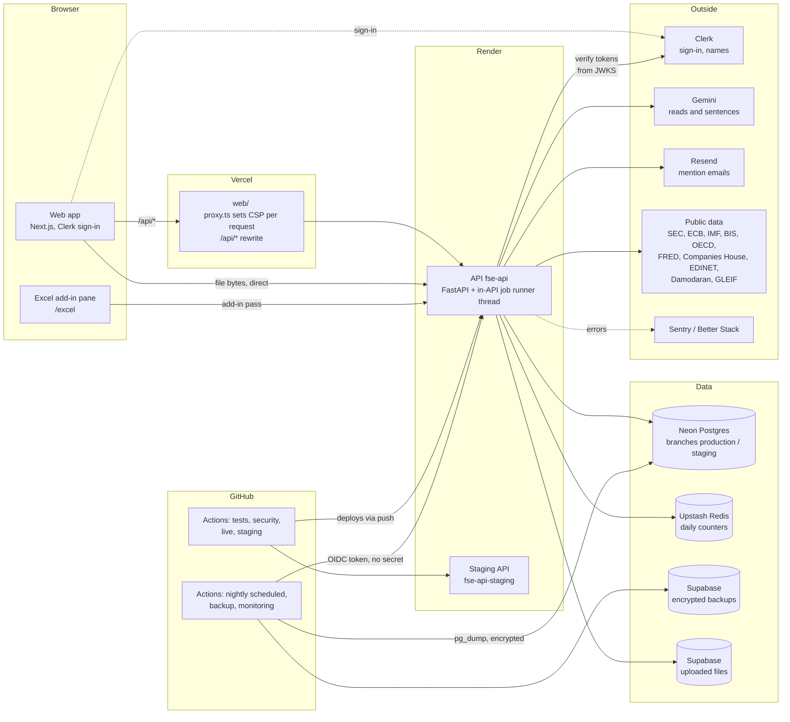
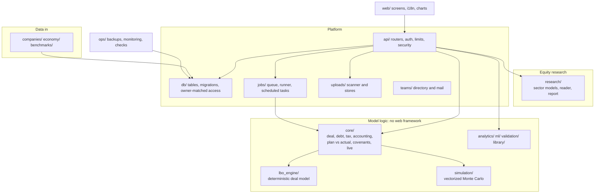

# Architecture

How the pieces of Variater fit, and the decisions behind them, with the
reasons. Most of these were made in sessions and recorded in CLAUDE.md,
DEPLOY.md and PLAN.md; this page collects them so the "why" is in one place.
For running the system see [MAINTAINING.md](MAINTAINING.md); for each
calculation see [methodology.md](methodology.md).

## The shape of it

Variater is an LBO modelling platform and an equity-research workspace. A
**Next.js web app** (`web/`) shows the screens; a **FastAPI API** (`api/`) runs
the models and stores data; a **Postgres database** (Neon) holds accounts and
saved work. Everything runs on free plans (PLAN.md phases 0 to 11); paid
tiers are switches prepared in advance (phase 12).

**Reading the diagram.** The browser talks only to Vercel, which proxies
`/api/*` to Render, so the browser needs no CORS. The one exception is file
upload, whose bytes go straight to the API's own address because Vercel does
not say how large a proxied request may be. GitHub Actions is the scheduler
and the checker: it calls the API with a token GitHub mints for each run.

## The code, in layers

- `core/` has **no web framework dependency**: functions take inputs and
  settings explicitly. The API is a thin layer over it.
- `lbo_engine/` and `simulation/` are the model proper. They are pinned by a
  golden snapshot (`tests/golden/`), so they change only with the owner's
  approval and a new engine version.
- `research/` is new code kept apart: a sector model is a table, evaluated by
  the server and written as Excel formulas from the same parsed rules.
- `web/` holds screens in `components/<mode>/`, state in providers mounted in
  `AppShell`, all text in `web/messages/<language>.json`.

## Decisions and why

### Hosting and cost

- **Free plans first; paid by a switch.** Phases 0 to 11 use only free tiers
  (Vercel Hobby, Render free, Neon, Upstash, GitHub Actions, Supabase, Clerk,
  Sentry, Better Stack, Resend). Phase 12 switches on paid tiers when a limit
  is actually reached or before charging customers. *Why:* a product that works
  inside the free limits is a product whose costs are understood before it has
  revenue. The switches and what each lifts are DEPLOY.md "Paid switches".
- **Vercel for the web, Render for the API.** Next.js is at home on Vercel;
  the model is a long-running Python process that fits a Docker web service.
  *Why Render's free tier:* 512 MB of memory is the constraint every
  simulation limit is sized from.
- **The browser talks only to Vercel, which proxies `/api`.** *Why:* no CORS
  setup, one origin for cookies and the content security policy, and the API's
  address can change without a client change. Rewrites are fixed at build
  time, so changing `FSE_API_URL` needs a redeploy.
- **Production and staging are the same code in two places.** Production
  deploys from `main`, staging from `staging`; previews always use the staging
  API. *Why:* a staging copy catches deployment problems before users do, and
  `staging` only ever receives `main` so it is never a different codebase.
- **Don't keep the free services awake.** `/api/health` never queries the
  database, the API opens no connection at start-up, the production uptime
  check is 30 minutes, and staging has no scheduled check (its deploy workflow
  is its monitor). *Why:* Render's 750 free hours and Neon's 100 compute hours
  are the scarcest resources; letting both sleep is how they last the month.
- **Domain with every record "DNS only".** *Why:* Vercel and Render issue
  their own certificates, and the security headers stay under the app's control.

### Data and money

- **One Postgres, accessed as a restricted role.** The API connects as
  `fse_api`, which can read and write rows and nothing else; the owner is used
  only for migrations (`DATABASE_MIGRATION_URL`). *Why:* an application bug or
  injection then cannot drop tables or rewrite grants. `/api/health/database`
  reports the role, and the daily checks fail if it is privileged.
- **Migrations run on first use, with an advisory lock.** Render's free plan
  has no pre-deploy command. *Why this is safe:* every migration must work with
  the previous code too (add first, drop later), because the old deploy keeps
  serving until the new one is live.
- **Pooled connections, one statement at a time.** Neon's pooler is in
  transaction mode, so no session state, advisory locks across statements or
  prepared statements on app connections. Migrations use the direct host.
- **Ownership is in the SQL, not in the handler.** Every read and write of a
  deal matches the caller's subject (or a team role) in the same statement, so
  another account's deal answers **404, never 403** and no code path can forget
  the check. Shared deals add the role in the same statement.
- **Compact storage for the free 0.5 GB.** A version is stored only when the
  content differs, autosave checkpoints are one per 15 minutes with the newest
  20 kept, settings are stored as overrides, and each feature has a byte budget
  that the database check reports and fails at 80%.
- **Nothing personal is stored.** The `users` table holds Clerk's user id plus
  country, currency, locale and time zone. Names and email addresses are read
  from Clerk per request when needed and never stored or logged. *Why:* less to
  protect, less to disclose; `/privacy` mirrors exactly what the code does.
- **Public data is shared, private data is owner-matched.** Company filings,
  economic series and Damodaran's tables carry no owner and nothing about who
  asked. Deals, files, memos and coverage belong to their owner.
- **Currency and unit are part of every deal; the engine runs in millions.**
  The engine rounds money to two decimals and is pinned to a snapshot in
  millions, so the router converts inputs to millions and the answer back.
  *Why:* it keeps one pinned engine and still lets a deal be in rupees, crores or
  thousands. No currency sign is hard-coded anywhere (a test fails on one).
- **Locale and language come from the account, not the URL.** Numbers, dates,
  digit grouping, language and text direction follow the account's locale, so
  addresses have no language prefix and the content security policy is built
  once. `lib/locale.ts` is the only place that turns numbers into text.
- **Every word is in a catalogue.** All interface text is in
  `web/messages/en.json` (next-intl), enforced by tests, so adding a language is
  adding a file. Labels the engine sends are model output and stay as sent.

### The model

- **Model logic is kept as is unless approved.** Fixes to the model are
  recorded as findings (CLAUDE.md "Model findings") and applied only with the
  owner's approval, each with a test that fails on the old code. The golden
  snapshot is never regenerated to go green.
- **Every result carries a model stamp.** Engine version, commit, settings
  fingerprint and data editions, so a saved deal can say "results changed since
  saved" and a reader can tell which model made a number.
- **Debt is a list of facilities that are presets over one mechanic.** Nine
  kinds, three new mechanics (PIK, the revolver, the sweep share). Pricing
  lives in `core/debt.py`, never in the engine, so market data can fill a rate
  path later without touching the engine. Every new engine default is an exact
  no-op so existing deals do not move.
- **One mechanic for the deal and the simulation** where they share a rule
  (tax, leases, tranche schedules), with a test that holds a simulated path at
  the mean to the deal model.
- **Market data never enters a run by itself.** The web offers today's
  benchmark level and the user applies it; the level is then a stored input.
  *Why:* a saved deal's answer must not move with the market.
- **Sourced figures, not guesses.** Starting inputs, ranges and correlations
  are read from named sources (Damodaran, the IMF, S&P, Global Credit Data)
  and shown with their source and sample. Where a source cannot support a
  figure it says "not enough data" rather than inventing one.
- **ML only where it beats a simple baseline.** Every model has a card tested
  walk-forward against a baseline; its output is shown only for regions where
  the card says it beats the baseline, and a pull request that makes a card
  worse is failed by `ops/model_gate.py`. Where a model could be replaced by the
  simulation itself (live sliders, driver explanations) the model was removed.
- **Research outputs are checked, not trusted.** A results reader runs two
  different models and flags every figure they disagree on; a note's or memo's
  figures are recomputed from the model every time they are drawn; the AI
  writes linking sentences from slot names only, never a number, and is never
  sent a company name or a figure.

### Safety and limits

- **Every API call needs a signed-in user** except the health checks and the
  schema. The dependency is on `include_router`, so a new route is protected
  unless added to `PUBLIC_PATHS`. Tokens are verified locally against Clerk's
  public keys: no Clerk secret and no Clerk quota on the hot path.
- **A development sign-in exists only where Clerk is not configured.** It makes
  local runs and browser tests possible and is refused in production.
- **Limits are part of the design.** Per user and per address request limits,
  a model-run limit, a 100,000-path cap sized from measured memory, one
  simulation at a time, a 100 s timeout and 1 MB bodies. Counting is in memory;
  only daily counts go to Upstash, in batches, with a hard daily command budget
  so a traffic spike cannot exhaust the free plan.
- **Uploads are hostile input.** The scanner uses real parsers in a child
  process with CPU, memory and time limits, refuses anything that can act, and
  the server alone writes to the store (no upload link is ever handed to a
  browser). A signed download link works for a minute and only for the owner.
- **Security headers and a per-request content-security policy.** Every page
  renders per request so a nonce can be added; a new third-party host must be
  added to the policy or the browser refuses it, and a browser test fails on a
  violation.
- **No deal contents in logs or Sentry.** No request bodies, query strings or
  local variables; request IDs link a browser error to a server log line.
- **Audit history is append-only for the API.** The restricted role may insert
  and read audit entries but never change them; entries never hold a figure,
  name or label.

### Jobs, schedules and recovery

- **A queue interface with the runner inside the API.** Long runs go through
  `/api/jobs`; the queue is a table (or memory), and the runner is a thread that
  starts on a submit or poll and stops after a minute idle. *Why:* Render's free
  tier has no worker machines and Neon should sleep. Phase 12 sets
  `FSE_JOB_RUNNER=external` and runs `python -m jobs.worker`: no endpoint changes.
- **GitHub Actions is the scheduler, signing in with OIDC.** The nightly
  workflows call task endpoints with a token GitHub mints for the run; the API
  checks the repository id, workflow file, branch and environment. *Why:* no
  stored scheduler secret to leak. Every run is logged in `scheduled_runs`.
- **Backups are encrypted, verified and drilled.** A nightly `pg_dump` is
  encrypted with AES-256-GCM (key in a GitHub secret and the owner's password
  manager), uploaded to a private bucket, rotated, then downloaded and decrypted
  to prove it. Monthly, a restore drill rebuilds it into a throwaway database
  and compares against what the manifest recorded at dump time. *Why:* a backup
  that has never been restored is a hope. Recent mistakes use Neon's own restore
  window instead.
- **Alerts come from the workflows.** Better Stack incidents are raised by the
  workflows that find the failure (`ops/betterstack.py incident`), and the
  uptime monitors and status page are code (`ops/betterstack.py sync`).

### How the work is built

- **One task, one PR; tests first; verify by output.** The cycle is
  [WORKFLOW.md](WORKFLOW.md). Tests assert real model output, not rendering,
  and are mutation-checked: several past bugs were controls that rendered fine
  and did nothing.
- **Twelve required checks on `main`**, with coverage floors that only rise and
  80% of changed lines covered. `main` is only reached by pull request.
- **Methodology is tested against the code.** `docs/methodology.md` names every
  model function and constant; a test fails when the document and code differ.
- **The docs that answer "why" live in the repository.** CLAUDE.md holds the
  current status and decisions, DEPLOY.md the setup of each service, PLAN.md the
  roadmap, this page the structure, and MAINTAINING.md how to run it.

## Where to look

| To understand | Read |
|---|---|
| What is built and what is next | CLAUDE.md "Current status", PLAN.md |
| How to set up an outside service | DEPLOY.md |
| How a number is calculated | [methodology.md](methodology.md) |
| How a model was tested | `docs/model-cards/`, `tests/reference/` |
| Threats and what is open | [security/threat-model.md](security/threat-model.md) |
| How to run, ship, restore | [MAINTAINING.md](MAINTAINING.md) |
